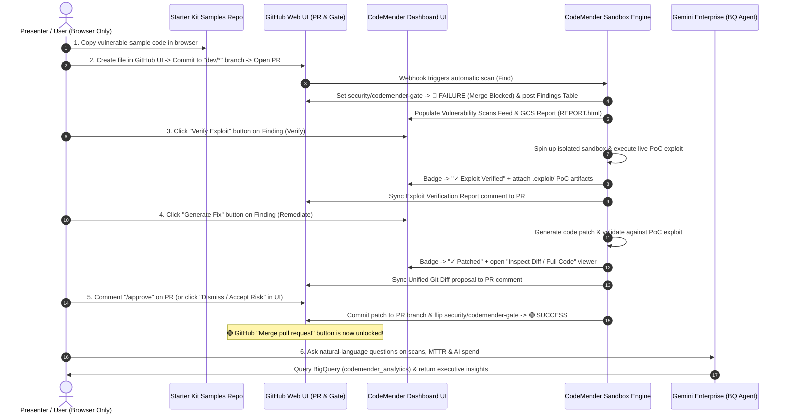

# 🚀 CodeMender in Action: End-to-End UI Demo & Walkthrough Guide

> **Don't just flag it, fix it:** Autonomous Security Triage, Sandbox Exploit Verification, and GitOps Patching—100% in Your Browser UI.

This guide walks you through running a complete **CodeMender** demonstration entirely through the **GitHub Web UI** and the **CodeMender Web Dashboard**—with **zero command-line setup required**. It includes both **step-by-step UI click paths** and **presenter talking points** (`🎙️ Presenter Talking Point`) for live demos.

---

## 🎯 Demo Storyline & Value Proposition

Traditional application security tools (SAST/DAST) flood developers with theoretical alerts inside separate security portals—leaving engineering teams to manually triage false positives, reproduce exploits, and write patches from scratch.

**CodeMender** shifts security from **passive alerting** to **autonomous remediation** directly inside the developer's browser workflow:
1. **Find (Autonomous Scan on PR):** When a developer commits code and opens a Pull Request on a `dev/*` or `feature/*` branch, CodeMender automatically runs QA & Semantic pre-checks and a deep vulnerability scan.
2. **Block (Automated PR Merge Gate):** CodeMender registers the `security/codemender-gate` status check on GitHub. If any **CRITICAL** vulnerability is detected, the GitHub **Merge pull request** button is physically locked (🔴 `Failure`).
3. **Verify (Live Sandbox Exploit Proof):** With one click in the UI, CodeMender spins up an isolated polyglot container sandbox, launches the app, and executes a real Proof-of-Concept (PoC) exploit—eliminating false-positive debates.
4. **Remediate (Verified Drop-In Patch):** With one click in the UI, CodeMender synthesizes a minimal code fix, re-runs the exploit in the sandbox to prove the vulnerability is neutralized, and posts the unified Git diff back to the Dashboard and GitHub PR.
5. **Approve or Override (Human-in-the-Loop Governance):** The reviewer either approves the patch (`/approve`) or accepts the risk via the UI Governance Modal (**Dismiss / Accept Risk**), automatically flipping `security/codemender-gate` to 🟢 **Success** and unlocking the PR merge button.
6. **Measure & Ask (FinOps Telemetry & Conversational BI in Gemini Enterprise):** Every scan, exploit verification, and patch is metered in BigQuery (`codemender_analytics`)—reconciled 1:1 against Google Cloud Billing SKUs in the **Token Usage & Costs** tab and queryable in natural language via the **[Gemini Enterprise (GE) Analytics Agent](https://vertexaisearch.cloud.google.com/home/cid/1f654f65-d330-4a56-808f-075c34cdb035?hl=en_US)**.

---

## 🗺️ End-to-End UI Demo Flow



---

## ✅ Pre-Demo Setup: Open 4 Browser Tabs (1 Minute)

No local terminal or IDE is needed. Simply open these **4 browser tabs** before starting:

1. **Tab 1 — CodeMender Starter Kit (Vulnerable Samples):**
   * 🔗 **[github.com/your-org/your-repo/tree/main/samples](https://github.com/your-org/your-repo/tree/main/samples)**
   * Contains ready-to-copy vulnerable files across Python, Go, Node.js, Java, and Terraform.
2. **Tab 2 — Your Target GitHub Repository:**
   * Open the GitHub repository wired to your CodeMender deployment (e.g., **[github.com/your-org/your-repo](https://github.com/your-org/your-repo)**).
3. **Tab 3 — CodeMender Web Dashboard (`CodeMender in Action`):**
   * Open your deployed `codemender-dashboard` URL. Confirm the status dot in the top-right header is pulsing green (**Connected**).
4. **Tab 4 — Gemini Enterprise (GE) BigQuery Analytics Agent:**
   * 🔗 **[Open CodeMender Analytics Agent in Gemini Enterprise](https://vertexaisearch.cloud.google.com/home/cid/1f654f65-d330-4a56-808f-075c34cdb035?hl=en_US)**
   * Connects directly to the Vertex AI Agent Engine runtime (`codemender-bq-analytics-agent`) to query live BigQuery security and FinOps telemetry in plain English.

### 📦 Available Vulnerable Samples in the Starter Kit
From **[`codemender-gitops/samples`](https://github.com/your-org/your-repo/tree/main/samples)**, pick the language that best matches your audience:

| Sample File in Starter Kit | Stack | Vulnerabilities Included | Demo Recommendation |
| :--- | :--- | :--- | :--- |
| **[`vulnerable_app.py`](https://github.com/your-org/your-repo/blob/main/samples/vulnerable_app.py)** | Python (Flask + SQLite3) | SQL Injection (`/login`), Command Injection, SSTI, Hardcoded AWS/Stripe keys | ⭐ **Best for Primary Demo** (Fastest end-to-end sandbox server spin-up & PoC verification) |
| **[`vulnerable_app.go`](https://github.com/your-org/your-repo/blob/main/samples/vulnerable_app.go)** | Go (`net/http` + SQLite3) | SQL Injection, IDOR, Command Injection, Hardcoded Slack/DB secrets | Great for compiled cloud-native / Go microservices audiences |
| **[`vulnerable_node.js`](https://github.com/your-org/your-repo/blob/main/samples/vulnerable_node.js)** | Node.js (Express) | Command Injection, Authentication Bypass, Hardcoded secrets | Great for full-stack JavaScript / TypeScript teams |
| **[`VulnerableController.java`](https://github.com/your-org/your-repo/blob/main/samples/VulnerableController.java)** | Java (Spring / JDK) | SQL Injection, Path Traversal, Insecure Deserialization | Great for enterprise Java engineering teams |
| **[`main.tf`](https://github.com/your-org/your-repo/blob/main/samples/main.tf)** | Terraform (GCP IaC) | Public GCS bucket (`allUsers`), Open Cloud SQL (`0.0.0.0/0`, unencrypted SSL) | Great for Cloud Infrastructure / DevSecOps teams |

---

## 🎬 Step 1: Commit Vulnerable Code & Open a PR in the GitHub UI (`Find`)

> [!TIP]
> **🎙️ Presenter Talking Point:**
> *"Developers don't want another security dashboard to check manually. With CodeMender, security starts automatically the moment a developer commits code and opens a Pull Request on a `dev/*` or `feature/*` branch. Let's grab a sample Python service from our Starter Kit, commit it directly in GitHub, and watch the automated merge gate in action."*

### UI Click-by-Click Instructions

1. **Copy a Vulnerable Sample from the Starter Kit (Browser Tab 1):**
   * Go to **[`codemender-gitops/tree/main/samples`](https://github.com/your-org/your-repo/tree/main/samples)** and click on **[`vulnerable_app.py`](https://github.com/your-org/your-repo/blob/main/samples/vulnerable_app.py)**.
   * Click the **Copy raw file** icon (two overlapping squares in the top-right corner of the code viewer).

2. **Create a New File in Your Target GitHub Repo (Browser Tab 2):**
   * Go to the main page of your target GitHub repository.
   * Click **Add file** (top right above the file list) $\rightarrow$ **Create new file**.
   * In the **Name your file...** input box at the top, type a filename such as:
     ```text
     demo_app.py
     ```
   * Paste the copied code into the web editor.

3. **Commit to a New `dev/*` Branch & Open a Pull Request:**
   * Click the green **Commit changes...** button in the top-right corner.
   * In the **Commit changes** dialog box:
     * Select the radio button: **Create a new branch for this commit and start a pull request**.
     * In the branch name input box, enter a branch name starting with **`dev/`** or **`feature/`** (this prefix triggers CodeMender automatically):
       ```text
       dev/demo-sqli-fix
       ```
     * Click **Propose changes**.
   * On the **Comparing changes** screen, click **Create pull request**.

4. **Watch the Automatic Security Gate & Scan in Both UIs:**
   * **In the GitHub PR UI (Tab 2):**
     * Scroll to the merge status box at the bottom of the PR.
     * Notice **`security/codemender-gate`** immediately appears in 🟡 **Pending** (*"CodeMender: Analyzing workspace security..."*).
   * **In the CodeMender Dashboard UI (Tab 3):**
     * Stay on the **GitOps Pipeline Dashboard** tab and click **Refresh Scan Feed** (or watch it auto-update).
     * A new card appears under **Vulnerability Scans Feed** for `Scan for Branch: dev/demo-sqli-fix`.
     * Click **▶ View Execution Steps** and **▶ View Console Logs** (`Scanner CLI Log`) to show the real-time progress as CodeMender runs QA & Semantic pre-checks followed by the deep vulnerability scan.

5. **Review the Scan Results & Blocked Merge Gate:**
   * When the scan card badge turns green (**`COMPLETED`**):
     * **In the CodeMender Dashboard (Tab 3):**
       * All detected vulnerabilities are listed under **Detected Vulnerabilities** with their ID (`ID: 1`, `ID: 2`, etc.), type (e.g., `SQL Injection`), and description.
       * Under **Research Artifacts (Cloud Storage)** at the bottom of the card, click **`REPORT.html`** to open the rich interactive security report in a new tab.
     * **In the GitHub PR UI (Tab 2):**
       * CodeMender automatically posts a **🔍 CodeMender Security Scan Results** table comment directly on the PR.
       * **`security/codemender-gate`** flips to 🔴 **Failure** (*"Merge Blocked: CRITICAL findings detected"*), physically locking the **Merge pull request** button!

---

## 🧪 Step 2: Verify Exploitability in the Dashboard UI (`Verify`)

> [!TIP]
> **🎙️ Presenter Talking Point:**
> *"Normally, when a scanner flags a vulnerability in a PR, developers push back saying 'that's a false positive' or 'that code path isn't reachable.' CodeMender eliminates the debate. With a single click in the dashboard, CodeMender spins up an isolated sandbox container, boots the application, and executes a live exploit payload to prove the vulnerability is real."*

### UI Click-by-Click Instructions

1. Go to the **CodeMender Dashboard UI (Browser Tab 3)** under **GitOps Pipeline Dashboard**.
2. Locate your scan card (`Scan for Branch: dev/demo-sqli-fix`) and find the target vulnerability (for example, **SQL Injection** — `ID: 1`).
3. Click the indigo **Verify Exploit** button on the right side of that finding row.
   * The button immediately changes to a spinning **`Verifying...`** indicator.
4. **Watch the Live Exploit Run in the UI Console:**
   * Click **▶ View Console Logs** at the bottom of the scan card and select the **Verification Log** tab.
   * Watch as the agent starts the Flask web server inside the container, verifies the local port is listening, and fires the crafted SQL Injection payload to bypass authentication.
5. **Inspect the Verification Proof Across Both UIs:**
   * **In the CodeMender Dashboard (Tab 3):**
     * The finding status badge flips to green: **✓ Exploit Verified**.
     * Under **Research Artifacts (Cloud Storage)**, new clickable proof-of-concept artifacts (such as the generated `.exploit/` script and output logs) appear.
     * A new green **Generate Fix** button automatically unlocks next to the verified finding!
   * **In the GitHub PR UI (Tab 2):**
     * Switch to the GitHub PR tab to show that CodeMender automatically stayed in sync—posting a **💥 CodeMender Exploit Verification Report** comment on the PR with the exact PoC exploit details and root-cause explanation.

---

## 🛠️ Step 3: Generate & Inspect the Security Patch in the UI (`Remediate`)

> [!TIP]
> **🎙️ Presenter Talking Point:**
> *"Now that CodeMender has proven the exploit works, let's fix it. When I click 'Generate Fix', CodeMender doesn't just guess a code change—it writes the security patch and re-runs the exact same exploit script from Step 2 inside the sandbox to guarantee the attack is blocked before ever showing the diff to the developer."*

### UI Click-by-Click Instructions

1. In the **CodeMender Dashboard UI (Browser Tab 3)**, look at the verified finding row (`✓ Exploit Verified`).
2. Click the green **Generate Fix** button.
   * The indicator updates to **`Generating...`**.
3. **Watch the Fix Agent Validate the Patch:**
   * In **▶ View Console Logs**, click the **Fix Agent Log** tab to watch CodeMender synthesize the parameterized SQL query fix and re-run the verification test suite in the sandbox.
4. **Inspect the Proposed Diff in the Dashboard UI:**
   * Once complete, the finding badge updates to **✓ Patched (PR Drafted)** and displays an **Inspect Diff** button.
   * Click **Inspect Diff** (or scroll down to the **Proposed Patches** section and click **Inspect Proposed Patch** on the PR card).
   * In the **CodeMender Proposed Patch** modal:
     * **Unified Git Diff Tab:** Shows the exact lines removed (`-`) and added (`+`).
     * **Full Patched Code Tab:** Opens a read-only Monaco code editor showing the complete remediated file in context.
     * Click **Close View** when finished inspecting.
5. **Check the GitHub PR Conversation (Browser Tab 2):**
   * Switch back to your GitHub PR tab. CodeMender has automatically posted the proposed **Unified Git Diff** directly in the PR conversation thread along with instructions on how to approve and apply it.

---

## ✅ Step 4: Approve the Patch & Unblock the Merge Gate (`Approve` / `Dismiss`)

> [!TIP]
> **🎙️ Presenter Talking Point:**
> *"Autonomous doesn't mean reckless. CodeMender keeps the developer in control with a Human-in-the-Loop gate. To apply the verified patch, the reviewer simply comments `/approve` on the PR—or, if a finding is an accepted business risk or protected by a WAF, they can dismiss it with an audited justification right from the UI. As soon as all critical findings are addressed, CodeMender unlocks the PR Merge button."*

### Path A: Approve & Auto-Commit the Patch from the GitHub PR UI

1. In the **GitHub PR UI (Browser Tab 2)**, scroll to the comment box at the bottom of the Pull Request.
2. Type:
   ```text
   /approve
   ```
   and click **Comment**.
3. **Watch CodeMender Apply the Fix & Clear the Gate:**
   * CodeMender commits the verified patch directly onto your `dev/demo-sqli-fix` branch using the original developer's Git identity (ensuring enterprise CLA checks pass).
   * CodeMender posts a **✅ CodeMender Patch Applied** confirmation comment on the PR.
   * In the **CodeMender Dashboard UI (Tab 3)**, click **Refresh Scan Feed**—the card under **Proposed Patches** now displays a green **`APPLIED`** badge!

---

### Path B: Governance Override / Risk Acceptance in the Dashboard UI (`Dismiss / Accept Risk`)

If your sample file had multiple findings and you want to demonstrate how teams handle false positives, test fixtures, or WAF-mitigated risks without writing code:

1. In the **CodeMender Dashboard UI (Browser Tab 3)**, locate any remaining unpatched finding on your scan card.
2. Click the amber **Dismiss / Accept Risk** button on that finding row.
3. In the **Dismiss Finding / Accept Risk** modal:
   * **Exemption Category:** Choose the appropriate governance category from the dropdown:
     * `False Positive / Unreachable Pattern`
     * `Compensating Control (WAF / Gateway / Network)`
     * `Non-Production / Test Mock Fixture`
     * `Unverifiable / Sandbox Exploit Inconclusive`
     * `Documented Business Risk Exemption`
   * **Justification Rationale:** Enter a brief audit note (e.g., *"Mitigated upstream by Cloud Armor WAF policy; exempting for demo release"*).
   * Click **Confirm & Update Gate**.
4. **Watch the Gate Clear Automatically:**
   * In the Dashboard, the finding badge turns amber: **`🟡 Dismissed (COMPENSATING_CONTROL)`**, and an immutable audit record is streamed to BigQuery.
   * Switch back to the **GitHub PR UI (Browser Tab 2)**: once all Critical findings on the PR are either **Patched** or **Dismissed**, the **`security/codemender-gate`** status check automatically flips from 🔴 **Failure** to 🟢 **Success**—and the green **Merge pull request** button unlocks!
   * *(Optional)* Click **Merge pull request** $\rightarrow$ **Confirm merge** in GitHub to stream the final Mean-Time-To-Remediate (MTTR) metrics into BigQuery.

---

## 🖥️ Step 5: Tour the Interactive Sandbox & FinOps Telemetry Tabs

Finish your walkthrough by clicking through the other two tabs at the top of the **CodeMender in Action** Dashboard (**Browser Tab 3**):

### 1. `Interactive Sandbox` Tab (Ad-Hoc Developer Playground)
> [!TIP]
> **🎙️ Presenter Talking Point:**
> *"What if a developer wants to check a snippet of code before even creating a branch or PR? The Interactive Sandbox gives them an in-browser editor with live AI pre-checks and a Human-in-the-Loop patch approval modal."*

1. Click **Interactive Sandbox** in the top navigation bar of the Dashboard.
2. The left pane displays an in-browser code editor (pre-populated with a vulnerable snippet, or you can paste any code from the **[Starter Kit Samples](https://github.com/your-org/your-repo/tree/main/samples)**).
3. In the **PROMPT / INTENT** field below the editor, enter what the code is supposed to do (e.g., *"Authenticate user login credentials securely"*).
4. Click **Submit for Review**.
5. Point out the live results on the right-hand panel:
   * **QA Intent Checker:** Confirms whether the code matches the developer's stated intent.
   * **Security & Hygiene Report:** Immediately flags hardcoded secrets, API keys, and code hygiene risks.
   * **Live Agent Reasoning Console:** Streams real-time agent execution logs.
   * **Review CodeMender Patch Proposal (HITL Approval Gate Modal):** When the agent finishes synthesizing a fix, a modal pops up showing the patched code. Click **Accept & Apply Patch** to update the editor live, or **Reject & Revert**.

---

### 2. `Token Usage & Costs` Tab (FinOps & BigQuery SKU Reconciliation)
> [!TIP]
> **🎙️ Presenter Talking Point:**
> *"Engineering and Security leaders always ask: 'What is our exact AI cost per scan, per exploit verification, and per remediated vulnerability?' This tab queries BigQuery in real time and reconciles every token 1:1 against Google Cloud Billing SKUs—including Context Caching savings."*

1. Click **Token Usage & Costs** in the top navigation bar of the Dashboard.
2. Use the date range buttons in the top-right corner (**Today**, **Yesterday**, **7 Days**, **30 Days**, or **Custom** calendar picker) to filter the metrics.
3. Highlight the **4 Executive Scorecards**:
   * **Total Invoiced Cost:** Total USD spend and token volume across the selected timeframe.
   * **Vertex AI Compute:** Layer 1 foundation model compute cost.
   * **CodeMender License:** Layer 2 autonomous security solution fee.
   * **Context Cache Savings:** Dollars saved by reusing cached repository context across multi-turn sandbox verification and patching runs.
4. Highlight the **Scanning Unit Economics & Remediation ROI** cards:
   * **Avg Cost Per Security Scan**
   * **Avg Cost Per Exploit Verification**
   * **Avg Cost Per Remediated Patch**
5. Scroll down to showcase the **GCP Billing SKU Reconciliation & Line-Item Breakdown** (showing exact Input, Output, Context Caching, and Helper Agent token volumes by SKU) as well as the **Cost by Code Repository**, **Cost by Agent Task Type**, and **Daily Token Spend Timeline** tables.

---

## 🤖 Step 6: Query Live BigQuery Telemetry via the Gemini Enterprise (GE) App

> [!TIP]
> **🎙️ Presenter Talking Point:**
> *"What if a CISO, VP of Engineering, or FinOps leader wants custom cross-repo reporting without writing SQL or opening the Google Cloud Console? We deployed a native ADK **BigQuery Analytics Agent** (`codemender-bq-analytics-agent`) onto **Vertex AI Agent Engine** and surfaced it directly inside **Gemini Enterprise**. With strict read-only SQL guardrails and automatic PII redaction, leaders can ask natural-language questions across our live BigQuery warehouse (`codemender_analytics`) to track remediation SLAs, vulnerability hotspots, and AI token unit economics."*

### UI Click-by-Click Instructions

1. Switch to **Browser Tab 4 — Gemini Enterprise (GE) App**:
   * 🔗 **[Open CodeMender Analytics Agent in Gemini Enterprise](https://vertexaisearch.cloud.google.com/home/cid/1f654f65-d330-4a56-808f-075c34cdb035?hl=en_US)**
2. In the Gemini Enterprise chat interface, select/invoke the **CodeMender BigQuery Analytics Agent** (`codemender-bq-analytics-agent`) from the Agents menu (or chat directly in the agent conversation).
3. Copy and paste any of the **Ready-to-Run Demo Prompts** below to showcase live BigQuery tool execution (`list_available_tables`, `run_aggregation`, `find_trends`, `compare_segments`, `execute_insight_query`, and `summarize_findings`):

### 💬 Ready-to-Copy Demo Prompts for the Gemini Enterprise Agent

#### 1. 🔍 Telemetry Catalogue & Schema Discovery
Start with this prompt to show how the agent introspects the `codemender_analytics` dataset and explains what tables are available:
```text
What telemetry tables are available in BigQuery for CodeMender, what key columns do they track, and can you show me a 5-row sample of recent scans?
```

#### 2. 🛡️ Security Posture & Scan Operations (`scan_log`)
Use these prompts to demonstrate real-time operational visibility across branches and repositories:
* **Scan Volume & Findings Breakdown:**
  ```text
  How many security scans were run recently, and which repository branch or target file triggered the highest number of vulnerability findings?
  ```
* **Action Taken & Gate Status Distribution:**
  ```text
  Group our scan_log table by status and action_taken so I can see how many scans completed, failed, or resulted in patches.
  ```

#### 3. ⚡ Remediation Velocity, MTTR & Engineering Leaderboard (`applied_security_patches`)
Use these prompts to show how engineering leadership tracks Mean Time to Remediate (MTTR) and patching rates:
* **MTTR & Patching Success Rate:**
  ```text
  What is our average time to remediate vulnerabilities (in seconds and minutes) and our overall security patching remediation rate across all merged PRs?
  ```
* **Top Security Contributors & Critical Fixes:**
  ```text
  Show me a breakdown of applied security patches by repository and developer (merged_by), including total critical and high vulnerabilities remediated.
  ```

#### 4. 💰 FinOps & AI Token Unit Economics (`token_usage_log`)
Use these prompts to show how FinOps and Platform teams audit LLM token consumption and cost per task:
* **Total Spend & Cost by Task Type (Scan vs. Verify vs. Fix):**
  ```text
  What is our total AI token spend in USD so far, and what is the total and average cost broken down by task_type (triage scan vs. exploit verification vs. patch generation)?
  ```
* **Model Utilization & Daily Spend Trend:**
  ```text
  Which AI models are used the most in token_usage_log, and can you show me the daily trend of total tokens and cost_usd over time?
  ```

#### 5. 📊 Executive CISO Briefing (Multi-Step Summary Tool)
Finish the GE App demo with a single executive prompt that combines data retrieval with the agent's `summarize_findings` tool:
```text
Query our scan_log, applied_security_patches, and token_usage_log tables, and generate a 4-sentence executive CISO summary covering our total vulnerabilities detected, average remediation speed, and average AI cost per remediated vulnerability.
```

---

## 🔧 Quick UI Tips & Demo Reset

* **How to Cancel an Active Scan or Verification in the UI:**
  If you ever want to stop an in-progress scan or verification during a live demo, simply click the red **Cancel** button on the top-right of the active scan card in the **GitOps Pipeline Dashboard** (or comment `/cancel` on the GitHub PR). This immediately stops the background worker and releases the workspace lock.
* **Why didn't my new branch trigger a scan?**
  When creating the branch in the GitHub Web UI (Step 1), make sure the branch name starts with **`dev/`** or **`feature/`** (for example, `dev/demo-1`). Commits pushed directly to `main` are ignored by design.
* **Can I also trigger Verify and Fix from the GitHub PR comments instead of Dashboard buttons?**
  Yes! Everything in CodeMender is bi-directionally synced. While clicking **Verify Exploit**, **Generate Fix**, and **Dismiss / Accept Risk** in the Dashboard UI is the easiest visual path, you can also type `/verify 1`, `/fix 1`, `/approve`, or `/dismiss 1 [FALSE_POSITIVE] reason` directly in the GitHub PR comment box.
