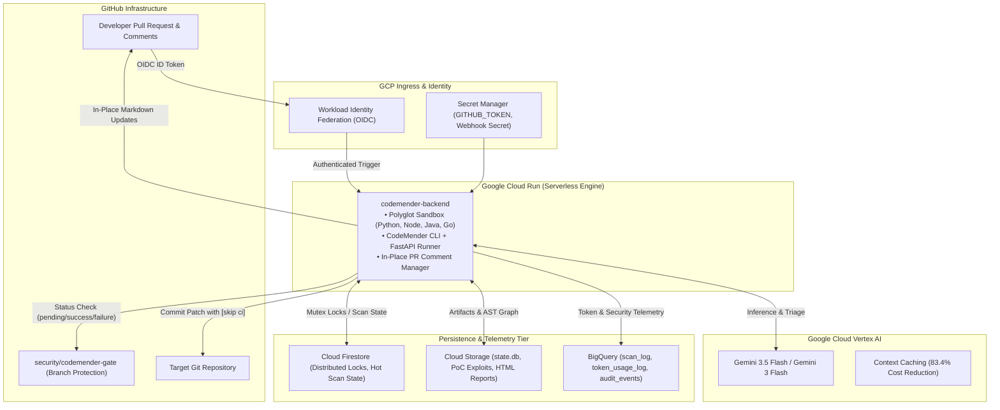

<!--
Copyright 2023 Google LLC

Licensed under the Apache License, Version 2.0 (the "License");
you may not use this file except in compliance with the License.
You may obtain a copy of the License at

    https://www.apache.org/licenses/LICENSE-2.0

Unless required by applicable law or agreed to in writing, software
distributed under the License is distributed on an "AS IS" BASIS,
WITHOUT WARRANTIES OR CONDITIONS OF ANY KIND, either express or implied.
See the License for the specific language governing permissions and
limitations under the License.

This code is for PoC environment only.
This demo code is not built for production workload.
-->

# 🛡️ CodeMender Enterprise GitOps Starter Kit

> ⚠️ **Disclaimer: This code is for PoC environment only. This demo code is not built for production workload.**

**CodeMender** is an enterprise-grade, autonomous GitOps security platform that embeds deeply into developer Pull Request workflows. Powered by Google Cloud Vertex AI (Gemini 3.5 Flash / Gemini 3 Flash) and deployed on Google Cloud Run, CodeMender acts as an autonomous Application Security (AppSec) engineer that:

1. **Scans Cumulative PR Diffs:** Analyzes complete changesets across multiple commits without wasting tokens on intermediate WIP commits.
2. **Dynamically Verifies Exploits:** Synthesizes executable Proof-of-Concept exploit scripts (`exploit.sh`) against polyglot mock targets inside isolated containers to confirm real exploitability with 100% confidence.
3. **Synthesizes Secure AST Patches:** Generates precision code fixes, stages them directly into GitHub PR comments, and commits the fix upon reviewer approval (`/approve`).
4. **Enforces Automated Merge Gates:** Blocks pull requests containing un-remediated Critical vulnerabilities (`security/codemender-gate`) while guaranteeing frictionless clearance once patched.

---

## 🏛️ System Architecture



---

## 📦 What's Included in This Starter Kit

```
codemender-starter-kit/
├── deploy.sh                  # 🚀 All-in-one automated GCP & WIF deployer script
├── Dockerfile                 # 🐳 Multi-stage container (Node/Next.js + Polyglot + Python + CLI)
├── config.example.env         # ⚙️ Configuration & environment variable reference
├── DEPLOYMENT_GUIDE.md        # 📖 Comprehensive manual infrastructure guide
├── POC_GUIDE.md               # 🧪 Step-by-step PoC validation guide & 7 test scenarios
├── README.md                  # 📘 Starter kit overview & developer guide
├── backend/                   # 🐍 FastAPI backend, agents, tools & BigQuery analytics
│   ├── agents.py              # AI agents (triage, verify, fix, QA, semantic review)
│   ├── cm_tools.py            # CodeMender CLI execution wrapper
│   ├── database.py            # Firestore hot-state, mutex locks & BigQuery telemetry
│   ├── gcs_helpers.py         # Cloud Storage artifact & state.db sync
│   ├── git_manager.py         # Ephemeral Git workspace manager
│   ├── github_helpers.py      # GitHub API, status checks & in-place PR comments
│   ├── main.py                # FastAPI webhook ingress & background task runner
│   ├── maintenance.py         # Ephemeral workspace cleaner & healthcheck
│   ├── requirements.txt       # Python dependencies
│   └── analytics_agent/       # Vertex AI Reasoning Engine telemetry agent
├── frontend/                  # ⚛️ Next.js 14 real-time security dashboard UI
└── samples/                   # 🧪 Polyglot vulnerable test samples
    ├── vulnerable_app.py      # Python SQL injection & command execution sample
    ├── vulnerable_node.js     # Node.js Express command injection sample
    ├── vulnerable_app.go      # Go path traversal sample
    ├── VulnerableController.java # Java Spring SQL concatenation sample
    └── main.tf                # Terraform misconfiguration sample
```

---

## ⚡ Quickstart: 1-Command Deployment

### Prerequisites
1. **Google Cloud Project** with billing enabled and `Owner` or `Editor` + `Security Admin` role.
2. **`gcloud` CLI** installed and authenticated (`gcloud auth login` and `gcloud auth application-default login`).
3. **GitHub Personal Access Token (PAT)** (Fine-Grained) with:
   - `Repository permissions -> Contents: Read & Write`
   - `Repository permissions -> Pull Requests: Read & Write`
   - `Repository permissions -> Commit Statuses: Read & Write`
   - `Repository permissions -> Issues: Read & Write`
4. **Target GitHub Repository** where you want to enable CodeMender scanning.

### Deployment Command
Run the automated deployment script from the starter kit root directory:

```bash
./deploy.sh \
  --project "your-gcp-project-id" \
  --region "us-central1" \
  --repo "your-github-org/your-repo-name" \
  --token "github_pat_xxxxxxxxxxxxxxxxxxxxxxxxxxxx"
```

The script automatically executes all provisioning steps:
- Enables all required Google Cloud APIs.
- Provisions Cloud Firestore in Native mode (`(default)`).
- Creates Cloud Storage artifact bucket (`gs://<project>-artifacts`).
- Initializes BigQuery analytics datasets and telemetry tables.
- Stores secrets securely in GCP Secret Manager (`GITHUB_TOKEN`, `GITHUB_WEBHOOK_SECRET`).
- Provisions Service Accounts with least-privilege IAM bindings (`codemender-runner`, `codemender-trigger`).
- Configures Workload Identity Federation (WIF) mapped to your target repository.
- Builds and deploys the CodeMender engine to Google Cloud Run.
- Generates the ready-to-use `.github/workflows/codemender.yml` file.

---

## 🔗 Step 2: Target Repository Setup

### 1. Add the GitHub Action Workflow
Copy the generated `.github/workflows/codemender.yml` file into your target repository's `.github/workflows/` directory and commit it to your default branch:

```yaml
name: CodeMender Agent Integration

on:
  pull_request:
    types: [opened, reopened, synchronize, ready_for_review]
  issue_comment:
    types: [created]

permissions:
  id-token: write
  contents: read

jobs:
  codemender-security-gate:
    if: >
      github.event_name == 'pull_request' ||
      (github.event_name == 'issue_comment' && github.event.issue.pull_request &&
       (startsWith(github.event.comment.body, '/verify') ||
        startsWith(github.event.comment.body, '/fix') ||
        startsWith(github.event.comment.body, '/approve') ||
        startsWith(github.event.comment.body, '/dismiss')))
    runs-on: ubuntu-latest
    steps:
      - name: Authenticate to Google Cloud (WIF)
        id: auth
        uses: google-github-actions/auth@v2
        with:
          token_format: 'id_token'
          workload_identity_provider: 'projects/<PROJECT_NUMBER>/locations/global/workloadIdentityPools/github-pool/providers/github-provider'
          service_account: 'codemender-trigger@<PROJECT_ID>.iam.gserviceaccount.com'
          id_token_audience: 'https://codemender-backend-<PROJECT_NUMBER>.<REGION>.run.app'
          id_token_include_email: true

      - name: Dispatch Scan / Slash Command to CodeMender
        run: |
          curl -sf -X POST "https://codemender-backend-<PROJECT_NUMBER>.<REGION>.run.app/github-webhook" \
            -H "Authorization: Bearer ${{ steps.auth.outputs.id_token }}" \
            -H "X-CodeMender-Auth: WIF" \
            -H "Content-Type: application/json" \
            -H "X-GitHub-Event: ${{ github.event_name }}" \
            -d @$GITHUB_EVENT_PATH
```

---

### 2. Configure GitHub Protected Branch Merge Gate
To guarantee that pull requests containing active Critical vulnerabilities cannot be merged:

1. In GitHub, navigate to **Settings $\rightarrow$ Branches**.
2. Click **Add branch protection rule** for `main` (or your production branch).
3. Check **Require status checks to pass before merging**.
4. Search for and select:
   👉 **`security/codemender-gate`**
5. Check **Do not allow bypassing the above settings** (enforces for repository admins).
6. Click **Save Changes**.

---

## 👩‍💻 Developer PR Workflow & Slash Commands

When a developer opens or updates a Pull Request:
1. **Automated Triage:** CodeMender scans the cumulative PR diff and sets `security/codemender-gate` to `PENDING 🟡`.
2. **In-Place PR Comment:** CodeMender posts a single, sticky markdown comment with all findings, CWE numbers, line snippets, and action buttons.
3. **Interactive Remediation Commands:** Developers and reviewers can interact directly via PR comments:

| Slash Command | Purpose & Engine Action |
| :--- | :--- |
| **`/verify [id\|all]`** | Spawns an isolated sandbox mock server, executes synthetic `exploit.sh`, and validates whether the vulnerability is truly exploitable (sets status to `VERIFIED` with 100% confidence). |
| **`/fix [id\|all]`** | Synthesizes an AST-level secure remediation patch, saves it to Firestore, and stages the unified git diff in the PR comment. |
| **`/approve`** | Applies the staged patch directly to the feature branch with `[skip ci]`, signs the commit with the author's identity, and marks the PR Ready for Review (`SUCCESS 🟢`). |
| **`/dismiss [id] [reason]`** | Records an authorized risk acceptance in BigQuery audit logs and unlocks the merge gate with a documented justification. |

---

## 🧪 Testing with Included Vulnerable Samples

To test the deployment end-to-end:

1. In your target repository, create a new branch:
   ```bash
   git checkout -b test-codemender-scan
   ```
2. Copy one of the test fixtures from `samples/`:
   ```bash
   cp samples/vulnerable_app.py app.py
   git add app.py
   git commit -m "feat: Add sample endpoint"
   git push origin test-codemender-scan
   ```
3. Open a Pull Request on GitHub.
4. Watch the GitHub Action trigger CodeMender on Cloud Run.
5. Review the in-place PR comment with the identified SQL injection finding.
6. Reply `/fix all` on the PR thread, inspect the generated patch diff, and reply `/approve` to merge the fix!

---

## 📊 Telemetry & Token Analytics

CodeMender automatically tracks all token usage and cost metrics in BigQuery (`codemender_analytics.token_usage_log`):
* **Dual-Tier Billing Reconciliation:** Tracks Vertex AI Compute (Layer 1) vs CodeMender Software License (Layer 2) matching Google Cloud Billing SKUs.
* **Context Caching ROI:** Tracks cache hit rates and dollar savings ($1.50/M vs $0.15/M cached input tokens).
* **Audit Trail:** Immutable records of all merged patches and risk dismissals.

---

## 📄 License
Licensed under the Apache License, Version 2.0.
