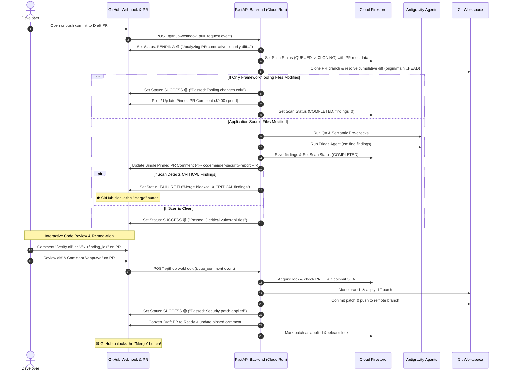

# CodeMender PoC: Automated Security Triage & Patching Workflow

> ⚠️ **Disclaimer: This code is for PoC environment only.**
> **This demo code is not built for production workload.**

<!--
Copyright 2023 Google LLC

Licensed under the Apache License, Version 2.0 (the "License");
you may not use this file except in compliance with the License.
you may obtain a copy of the License at

     https://www.apache.org/licenses/LICENSE-2.0

Unless required by applicable law or agreed to in writing, software
distributed under the License is distributed on an "AS IS" BASIS,
WITHOUT WARRANTIES OR CONDITIONS OF ANY KIND, either express or implied.
See the License for the specific language governing permissions and
limitations under the License.
-->

This project is a Proof of Concept (PoC) for **CodeMender**, an autonomous security agent pipeline that monitors a developer codebase, detects vulnerabilities upon Draft Pull Requests, verifies exploitability using sandboxed runtimes, proposes secure code fixes, enforces automated PR merge quality gates, and automatically applies patches when authorized.

---

## 🔍 What We Are Doing

Modern CI/CD security scanning tools alert developers of security issues on noisy intermediate commits but leave the remediation to manual code reviews. **CodeMender** transitions security scanning to a **Draft PR-Driven Architecture**:
1. **Draft PR-Driven Ingress**: Scans trigger exclusively when a developer opens or updates a Pull Request (`pull_request` webhook: `opened`, `synchronize`, `reopened`, `ready_for_review`). Raw WIP pushes on feature branches are ignored with HTTP 200, eliminating 60%–75% of token waste.
2. **Cumulative Merge-Base Diffing**: Uses triple-dot diffing (`origin/{base_branch}...HEAD`) to evaluate the full cumulative delta across all commits in the PR.
3. **Zero-Token Tooling Bypass ($0 Spend)**: PRs touching only framework/tooling files (`backend/`, `frontend/`, `scripts/`, `.github/`, `.gemini/`) bypass heavy LLM scans, immediately setting 🟢 `SUCCESS` and logging $0.00 spend.
4. **Pre-Checks & CodeMender Triage**: For application changes, runs Quality Assurance and Static Analysis (Semantic) pre-checks concurrently before running CodeMender CLI triage (`cm find`).
5. **Single Pinned PR Report**: Posts and updates a single dynamic security comment on the PR using the `<!-- codemender-security-report -->` anchor tag, eliminating duplicate bot comment noise.
6. **Active Task Superseding**: When a developer pushes a newer commit to an active PR, in-flight scanning tasks for previous commits are superseded and cancelled.
7. **Automated Security Merge Gate**: Registers a GitHub Commit Status Check (`security/codemender-gate`). If **Critical** vulnerabilities exist, PR merges are **physically blocked** until resolved.
8. **Interactive Patching & Verification**: Developers can reply with `/verify <finding_id>` for sandboxed exploit verification or `/fix <finding_id>` to generate a secure patch.
9. **Automerge Fix & Gate Clearance**: Upon `/approve`, CodeMender applies the patch locally, commits, pushes, promotes the Draft PR to **Ready for Review**, and automatically clears the merge gate (turning `security/codemender-gate` to 🟢 **SUCCESS**).

### 💡 Core Production Capabilities
* 🛡️ **Automated PR Merge Gate (`security/codemender-gate`)**: Enforces repository branch protection. Pull requests with $\ge 1$ CRITICAL findings cannot be merged until patched.
* 📝 **Draft PR-Centric Workflows**: Native Draft PR badges (`📝 Draft PR #` / `🚀 Pull Request #`) and direct links across the Dashboard UI.
* 📌 **Single Pinned PR Comment**: Updates the security report in-place on every PR commit push (`PATCH /repos/{repo}/issues/comments/{comment_id}`).
* 📦 **Pre-Baked Polyglot Execution Sandboxes**: Container image pre-bakes full compilers and runtimes for Go (`golang-go`), C/C++ (`build-essential`, `gcc`, `g++`), Java (`default-jdk`, `maven`), Node.js (`express`, `axios`), Python (`flask`, `requests`), Netcat (`netcat-openbsd`), and SQLite3, completely eliminating dynamic `apt-get` memory spikes and OOM failures.
* ⚡ **Threshold-Based Finding Sharding (Threshold = 4)**: Scans with $\le 4$ findings execute in a clean sequential loop with workspace resets; scans with $> 4$ findings automatically fan out across parallel worker containers for sub-3-minute verification.
* 📊 **Exact GCP Billing SKU Telemetry**: Aligns token usage calculations directly with Google Cloud Vertex AI Billing SKUs ($1.50/1M input, $9.00/1M output, $0.15/1M caching for Gemini 3.5 Flash; $2.50/1M thinking for Gemini 2.5 Flash), groups daily telemetry by Pacific Time (`America/Los_Angeles`), and records `pr_number`, `is_draft`, and `event_type`.
* 🌐 **Dynamic Multi-Repository Target Extraction**: Dynamic repository identity extraction across all webhook and background worker tasks (`GitWorkspace(head_sha, repo=repo_name)`), allowing CodeMender to seamlessly serve multiple enrolled repositories under scoped GitHub Apps and fine-grained PAT tokens without 403 Forbidden errors.
* 🔄 **Dashboard & GitHub In-Sync**: Any manual action triggered from the Next.js UI dashboard automatically syncs back to GitHub, posting start/progress updates and uploading final sandbox verification reports.
* 🔒 **Role Separation**: Webhook gateway runs with `DISABLE_UI=True` for security, while `codemender-dashboard` serves the dedicated user interface.

---

## 🏗️ Architecture & Component Flow

### 📡 Webhook, PR Scan & Security Gate Lifecycle


---

## 📁 Repository Structure & Component Map

Below is the file layout of the CodeMender engine:
```
codemender-gitops/
├── Dockerfile                  # Pre-baked polyglot container image (Go, GCC, JDK, Node, Netcat, Python).
├── README.md                   # Complete architectural guide and reference.
├── backend/                    # FastAPI python web server hosting webhooks and REST APIs.
│   ├── main.py                 # Main entrypoint; handles routing, merge gates, and threshold sharding.
│   ├── agents.py               # Google Antigravity SDK agents configurations (Triage, Semantic, QA).
│   ├── database.py             # Firestore client, distributed locks, SKU pricing & JSONL session parsers.
│   ├── cm_tools.py             # Antigravity tool bindings executing native CodeMender CLI commands.
│   ├── git_manager.py          # Local GitWorkspace manager handling checkouts, merges, commits, and pushes.
│   ├── github_helpers.py       # GitHub REST API wrapper (PR comments, commit statuses, draft conversion).
│   ├── gcs_helpers.py          # Google Cloud Storage helper for saving logs, states, and exploit outputs.
│   ├── shared_state.py         # Lock registries to prevent overlapping hook runs.
│   ├── test_webhook.py         # Webhook simulators to mock pushes and comment triggers locally.
│   └── requirements.txt        # Python package dependencies.
├── frontend/                   # Next.js 14 Web UI Dashboard application.
│   ├── src/                    # Frontend source (NextJS pages, styling, tailwind UI components).
│   ├── package.json            # Node.js dependencies and run scripts.
│   └── tailwind.config.js      # Tailwind CSS theme setup.
└── scripts/                    # Platform management helper scripts.
    ├── push_engine.py          # Syncs local workspace updates directly into the repository.
    └── setup_gcp.sh            # Provisioning script for GCP APIs, Firestore databases, and Secrets.
```

---

## ☁️ Production GCP Resources & Cloud Run Services

The production environment operates under the GCP project `YOUR_PROJECT_ID` (region `us-central1`):

### 1. Cloud Run Services (Scaled to 2 GiB RAM, 2 vCPUs)
* **`codemender-webhook`**: Webhook gateway (`DISABLE_UI=True`, `concurrency=80`, `2 GiB RAM`, `2 vCPU`, `600s timeout`).
* **`codemender-backend`**: Dedicated execution worker (`concurrency=1`, `2 GiB RAM`, `2 vCPU`, `600s timeout`).
* **`codemender-dashboard`**: Dedicated Next.js web portal (`2 GiB RAM`, `2 vCPU`).

### 2. Cloud Firestore Collections
* **`scans`**: Keyed by commit SHA. Findings, PR number, status, the task that owns it (`active_task`: scan/verify/fix), `scan_completed_at`, a heartbeat (`updated_at`, refreshed every 60 s while a task runs), the changed files scanned and not scanned, and real-time execution steps.
* **`patches`**: Keyed by the scanned commit SHA. The PR being fixed (`pr_number`), the patch PR (`patch_pr_number`), every changed file and the full diff.
* **`locks`**: Workspace leases (`workspace-{commit_sha}`) with an owner and an expiry. Only the owner releases a lease; only expired leases are swept.
* **`processed_comments`**: One record per handled comment command, so a redelivery runs it at most once (kept 365 days).

### 3. BigQuery Telemetry Warehouse
* **Dataset**: `codemender_analytics`
* **Table 1: `token_usage_log`** (Dual-Tier Financial & Agent Telemetry):
  * `log_id` (STRING), `timestamp` (TIMESTAMP), `repo_name` (STRING), `session_id` (STRING), `task_type` (STRING), `model_name` (STRING)
  * `input_tokens` (INTEGER), `output_tokens` (INTEGER), `cached_tokens` (INTEGER), `thoughts_tokens` (INTEGER), `total_tokens` (INTEGER)
  * `cost_usd` (FLOAT), `duration_sec` (FLOAT)
  * `pr_number` (INTEGER), `is_draft` (BOOLEAN), `event_type` (STRING: `pull_request`, `issue_comment`, `commit_comment`, `dashboard`)
  * `compute_cost_usd` (FLOAT), `license_cost_usd` (FLOAT), `cached_savings_usd` (FLOAT), `pricing_tier` (STRING: `DUAL_TIER_CODEMENDER` for cm tasks, `SINGLE_TIER_COMPUTE` otherwise)
* **Table 2: `scan_log`** (Scan Execution & Triage Audit):
  * `scan_id` (STRING), `timestamp` (TIMESTAMP), `commit_sha` (STRING), `repo_name` (STRING), `branch_name` (STRING)
  * `event_type` (STRING), `status` (STRING), `target_file` (STRING), `findings_count` (INTEGER), `findings_list` (STRING), `action_taken` (STRING)
  * `pr_number` (INTEGER), `is_draft` (BOOLEAN), `cost_usd` (FLOAT), `cached_savings_usd` (FLOAT)
* **Table 3: `applied_security_patches`** (Remediation & MTTR Velocity Metrics, one row per merged PR):
  * `merge_id` (STRING), `pr_number` (INTEGER), `repo_name` (STRING), `branch` (STRING), `commit_sha` (STRING), `merged_at` (TIMESTAMP), `merged_by` (STRING), `time_to_remediate_sec` (INTEGER)
  * `total_findings`, `critical_count`, `high_count`, `medium_count`, `low_count`, `verified_count`, `patched_count`, `unpatched_count` (INTEGER), `verified_finding_ids`, `patched_finding_ids`, `unpatched_finding_ids` (STRING)
  * `remediation_rate_pct` (FLOAT), `findings_full_json` (STRING)
* Every streamed row is trimmed to the live table's columns first, so a column added in code never fails an insert before the table has it.

### 4. Cloud Storage (GCS) Structure
Bucket `YOUR_PROJECT_ID-artifacts` stores all research and run outputs:
* **`sessions/{commit_sha}/REPORT.html`**: The interactive security security scan report generated by `cm report`.
* **`sessions/{commit_sha}/REPORT.md`**: Markdown representation of the scan findings.
* **`sessions/{commit_sha}/.exploit/...`**: Logs, exploit scripts, and output files from the sandbox verification run.
* **`sessions/{commit_sha}/state.db`**: The SQLite database state containing vulnerability findings used by the CodeMender CLI.

### 4. Secret Manager
* **`GITHUB_TOKEN`**: GitHub token for checks, comments, PRs and patch pushes. Target: a fine-grained PAT scoped to `YOUR_ORG/YOUR_REPO` (Contents, Pull requests, Issues, Commit statuses, Checks: read/write; Metadata: read, needed for the commenter permission check).
* **`GITHUB_WEBHOOK_SECRET`**: Shared secret key validating webhook payloads sent by GitHub.

---

## 🔒 Security & Access Control

1. **No Public Ingress**: Public anonymous access is disabled for both `codemender-backend` and `codemender-webhook` services (`allUsers` invoker bindings are removed). The webhook is invoked only by `codemender-trigger@`, through Workload Identity Federation from this repository's relay workflow.
2. **IAP Protection**: The dashboard sits behind Google **Identity-Aware Proxy (IAP)**; every state-changing route requires a verified IAP identity (no client-supplied identity headers).
3. **Event Validation**: Relayed events are re-read from the GitHub API before anything runs. Slash commands run only for collaborators with `write` or `admin` permission, and each comment runs at most once.
4. **Execution Isolation**: The image runs as an unprivileged user, cm subprocesses get an allowlisted environment (no tokens or secrets), and the cm download is checked against a pinned sha256.

---

## 🛠️ How to Run & Demo CodeMender (Live Workflow)

To run a full scan and patching demo against the target repository:

### Step 1: Check Local Configurations
Locally, the CodeMender CLI configuration is located in `~/.codemender/config.yaml`. Verify that `.sh` and `.tf` files are allowed in your scan list:
```yaml
scan:
  extensions:
    include: [".py", ".java", ".go", ".js", ".ts", ".c", ".cc", ".cpp", ".h", ".rb", ".php", ".sh", ".tf"]
```

## 🛡️ Enabling GitHub Branch Protection (Security Merge Gate)

To physically block developers from merging PRs containing Critical vulnerabilities:

1. Open your GitHub Repository $\rightarrow$ **Settings** $\rightarrow$ **Branches**.
2. Under **Branch protection rules**, click **Add rule** for the default branch (`main`).
3. Enable:
   * ✅ **Require a pull request before merging**
   * ✅ **Require status checks to pass before merging**
   * ✅ **Require branches to be up to date before merging**
4. In the search box, select **`security/codemender-gate`**.
5. Save changes.

---

## 🛠️ How to Run & Demo CodeMender

### Step 1: Push Vulnerable Code
Open a pull request to `main` (Draft or Ready for Review). CodeMender automatically:
1. Sets GitHub Status check to 🟡 `pending`.
2. Runs triage scan and identifies findings.
3. If Critical findings exist, sets GitHub Status check to 🔴 `failure` (blocking merges). A scan that fails or is interrupted ends at `error`, never `success`.
4. Posts one report comment on the PR, edited in place on every new push. Changed files over `CM_MAX_SCAN_FILES` are listed and keep the gate failing.

### Step 2: Run Exploit Verification
Comment `/verify all` (or `/verify <finding_id>`) on the PR.
* Findings are verified one at a time on the scanned commit, resetting git state between tests.
* `/fix <finding_id>` generates a patch on a `codemender/patch-*` branch; `/cancel` stops a running scan, verify or fix within seconds.

### Step 3: Approve & Unblock Merge
Comment `/approve` on the PR. CodeMender:
1. Pushes the approved patch to the PR branch.
2. The push starts a new scan of the patch commit, and that scan sets `security/codemender-gate` (🟢 `success` when no unresolved Critical findings remain).
3. A Draft PR whose gate turns green is promoted to Ready for Review.

### Step 4: Dismiss / Override Gate (Risk Acceptance)
If a Critical finding is a false positive, test fixture, or protected by external controls:
* **Option A (GitHub PR Slash Command):**
  ```text
  /dismiss 0ad2a347 [FALSE_POSITIVE] Internal diagnostic route; sanitized by Cloud Armor WAF
  ```
  *(Emergency lead override for all active criticals on the commit: `/override-gate [EMERGENCY_HOTFIX] Authorized by SecOps lead`)*
* **Option B (Next.js Dashboard):** Click **Dismiss / Accept Risk** on the finding card, select a governance category, enter $\ge 10$ character justification, and submit.
* **Result:** The system logs an audit row to BigQuery, recalculates remaining active criticals, and flips `security/codemender-gate` to 🟢 `success` if 0 active criticals remain. This only applies to a completed scan that covered every changed file; a dismissal never turns a failed, running or partial scan green.

---

## 🛡️ Governance & Risk Acceptance Categories

CodeMender provides standardized risk acceptance categories for compliance auditing:

| Category | Description | Use Case |
| :--- | :--- | :--- |
| `[FALSE_POSITIVE]` | Tool misidentification or safe usage pattern | Sanitized upstream or AST false match |
| `[COMPENSATING_CONTROL]` | Mitigated by external infrastructure | Protected by Cloud Armor WAF / API Gateway |
| `[NON_PROD_FIXTURE]` | Non-production mock or benchmark fixture | Test helper files not shipped to prod |
| `[UNVERIFIABLE]` | Sandbox exploit failed to reproduce | Unreachable in current deployment architecture |
| `[BUSINESS_ACCEPTED_RISK]` | Documented business exemption | Emergency hotfix approved by SecOps lead |

All dismissals stream immutable audit logs to BigQuery table **`codemender_analytics.dismissed_vulnerabilities_audit`**.

---

## 📊 Multi-Project Remediation Velocity & Executive Scorecards

Developers and security leads across enrolled repositories can track remediation velocity and view executive KPI cards directly on the Web Portal:

```
┌───────────────────────────┬───────────────────────────┬───────────────────────────┐
│ 🛡️ Remediated Vulns       │ ⚡ Mean Time to Remediate │ 📈 Remediation Rate (%)   │
│ 14 Patched                │ 4.2 Minutes (Avg)         │ 93.3% Resolution          │
│ 🔴 6 Critical | 🟠 8 High │ ⚡ Automated AI Speed      │ 14 Fixed / 15 Discovered  │
└───────────────────────────┴───────────────────────────┴───────────────────────────┘
```

### 1. Automatic Telemetry Streaming
Whenever a patch is merged on any enrolled repository (`/approve` or Dashboard Approval), CodeMender streams telemetry to:
* **Table:** `YOUR_PROJECT_ID.codemender_analytics.applied_security_patches`
* **Data Captured:** `repo_name`, `branch`, `pr_number`, `patched_count`, `critical_count`, `high_count`, `time_to_remediate_sec` (MTTR), `remediation_rate_pct`, and `merged_by`.

### 2. Multi-Repo Filtering & Date Windows
* **Repository Selector:** Filter by all repositories or select an isolated repository (e.g. `YOUR_ORG/YOUR_REPO`).
* **Date Presets & Custom Calendar:** Filter metrics by `Today (24h)`, `Yesterday`, `Last 7 Days`, `Last 30 Days`, or custom UTC date range.

### 3. Direct BigQuery SQL Queries (Looker Studio / Grafana)

#### 30-Day Executive Remediation Scorecard by Repository:
```sql
SELECT 
  repo_name,
  SUM(patched_count) AS total_vulnerabilities_patched,
  SUM(critical_count) AS critical_remediated,
  SUM(high_count) AS high_remediated,
  COUNT(DISTINCT pr_number) AS total_prs_merged,
  ROUND(AVG(time_to_remediate_sec) / 60, 1) AS avg_mttr_minutes,
  ROUND(AVG(remediation_rate_pct), 1) AS avg_remediation_rate_pct
FROM `YOUR_PROJECT_ID.codemender_analytics.applied_security_patches`
WHERE merged_at >= TIMESTAMP_SUB(CURRENT_TIMESTAMP(), INTERVAL 30 DAY)
GROUP BY repo_name
ORDER BY total_vulnerabilities_patched DESC;
```

#### Month-over-Month Security Velocity & MTTR Trend:
```sql
SELECT 
  FORMAT_TIMESTAMP('%Y-%m', merged_at) AS report_month,
  repo_name,
  SUM(patched_count) AS total_patches,
  ROUND(AVG(time_to_remediate_sec) / 60, 1) AS avg_mttr_minutes
FROM `YOUR_PROJECT_ID.codemender_analytics.applied_security_patches`
GROUP BY report_month, repo_name
ORDER BY report_month DESC;
```

---

## 🚀 Releasing (`scripts/release.sh`)

Traffic on all three services is pinned to explicit revisions, so nothing goes live without a promotion. Every step except `status` changes Cloud Run state and needs approval.

1. `scripts/check.sh`: compileall, shell syntax, local imports, scope lint, unit tests.
2. `scripts/release.sh build`: Cloud Build of the committed HEAD → `codemender-backend:<sha>` (never `:latest`).
3. `scripts/release.sh deploy`: one no-traffic revision per service, tagged `sha-<short>`, with the image pinned by digest. Config changes ride along as `DEPLOY_FLAGS` / `DEPLOY_FLAGS_<SERVICE>`.
4. `scripts/release.sh smoke`: digest, `MOCK_MODE=false` and service account of each new revision, then health and auth checks on the webhook and backend tag URLs (the dashboard is checked through the load balancer after promotion).
5. `scripts/release.sh promote`: refuses while a scan, verify or fix is running (`FORCE=1` overrides), then pins 100% to the new revisions and prints the rollback commands.
6. Rollback: `scripts/release.sh rollback <service> <previous revision>`.

## ⚙️ Runtime Settings

| Variable | Default | Meaning |
|---|---|---|
| `ALLOWED_REPOS` | required in production | Repositories the service acts on |
| `CM_MAX_SCAN_FILES` | 20 (1–100) | Changed files scanned per PR head; files over the limit keep the gate failing |
| `CM_FIND_TIMEOUT_SEC` / `CM_VERIFY_TIMEOUT_SEC` / `CM_FIX_TIMEOUT_SEC` | 600 / 1200 / 1200 | Per-run cm deadlines (60–3000 s) |
| `CM_MAINTENANCE_INTERVAL_SEC` | 300 on Cloud Run, off locally | In-process maintenance sweep; 0 disables it |
| `CM_STALE_TASK_SEC` | 600 (600–21600) | Heartbeat age after which in-flight work counts as abandoned |
| `CM_COMMENT_RETENTION_DAYS` | 365 (at least 31) | How long comment-command dedupe records are kept |
| `CM_DISABLE_SANDBOX` | unset | Emergency lever only: disables the cm OS sandbox |

## 🧯 Operations Runbook

* **Instance restarts:** on SIGTERM the service flags a shutdown. Running cm commands stop within 2 s, interrupted scans become `STALE` ("interrupted by a service restart") with an `error` gate, verify/fix records are restored, and leases are released. Re-run by pushing a commit or reopening the PR.
* **Abandoned work:** every 5 minutes the sweep closes out scan records whose heartbeat is older than 10 minutes (allowed repositories only), deletes expired leases, removes old `/tmp` workspaces that aren't in use and prunes old dedupe records. `/api/maintenance/gc` runs the same cycle on demand (IAP user or allowlisted OIDC caller).
* **Stopping work:** `/cancel` (or the dashboard) asks the running task to stop at its next checkpoint. A lease is force-released only once it has expired.
* **Never** edit env vars or delete locks on live revisions by hand: config changes go through `release.sh deploy` + `promote`.

## 📚 Architectural Blueprints & Playbooks
* 📘 **Rollout Playbook:** [`codemender_rollout_playbook.md`](./codemender_rollout_playbook.md) — Step-by-step instructions to roll out this architecture to new repositories.
* 🔄 **Concurrency & Parallel Flows:** [`parallel_execution_flows.md`](./parallel_execution_flows.md) — Visual flowcharts for same-commit locking, cross-commit concurrency, and map-reduce sharding.
* 🏛️ **Enterprise VPC Architecture:** [`enterprise_private_gitops_vpc_architecture.md`](./enterprise_private_gitops_vpc_architecture.md) — Direct VPC Egress, Cloud Armor, Cloud NAT Static IPs, and Private Git connectivity.

