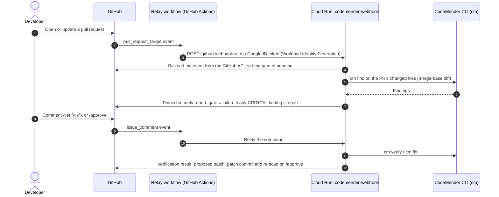

# CodeMender GitOps Starter Kit: Security Triage and Patching in Pull Requests

> ⚠️ **Disclaimer: This code is for PoC environments only.** It is not built for production
> workloads, and it is not an officially supported Google product.

<!--
Copyright 2023 Google LLC

Licensed under the Apache License, Version 2.0 (the "License");
you may not use this file except in compliance with the License.
You may obtain a copy of the License at

     https://www.apache.org/licenses/LICENSE-2.0

Unless required by applicable law or agreed to in writing, software
distributed under the License is distributed on an "AS IS" BASIS,
WITHOUT WARRANTIES OR CONDITIONS OF ANY KIND, either express or implied.
See the License for the specific language governing permissions and
limitations under the License.
-->

This starter kit runs **CodeMender** in your pull requests. When a developer opens or updates a pull
request, CodeMender scans the files the PR changes, posts a single pinned security report on the PR,
and sets a merge gate (`security/codemender-gate`). From PR comments, developers can then:

- verify a finding with a sandboxed exploit (`/verify`),
- get a proposed fix (`/fix`),
- commit the approved fix to the PR branch (`/approve`), which re-scans the PR and updates the gate.

> **Access:** CodeMender is in Public Preview with gated access. Your Google Cloud project must be
> allowlisted to download and run the CodeMender CLI (`cm`).

> **This release has no web dashboard.** Everything runs from pull requests and PR comments. The
> Cloud Run services expose an API only.

---

## How it works



Key behaviors:

1. **PR-driven scans.** Scans run on `pull_request` events (`opened`, `synchronize`, `reopened`,
   `ready_for_review`). Raw branch pushes are ignored.
2. **Cumulative diff.** The changed files come from a merge-base diff
   (`origin/<base>...HEAD`), so every commit in the PR counts.
3. **Single pinned report.** One PR comment, marked `<!-- codemender-security-report -->`, is
   updated in place on every scan.
4. **Merge gate.** `security/codemender-gate` fails while a CRITICAL finding is open, and on scans
   that did not complete. A failed or partial scan is never a pass.
5. **Superseding.** A newer commit on the PR supersedes in-flight work for older commits.
6. **Deterministic severity.** Severities are normalized against a fixed CWE policy (for example,
   SQL injection and OS command injection are CRITICAL, XSS and IDOR are HIGH, hardcoded secrets
   are MEDIUM).

---

## What's in this repository

```
.
├── Dockerfile                    # Polyglot runtime image (Python, Go, Java, Node.js, SQLite) + the cm CLI
├── deploy.sh                     # One-time bootstrap: APIs, Firestore, bucket, secrets, Cloud Run services
├── backend/                      # FastAPI service: webhook, PR scan worker, PR commands, merge gate
│   └── tests/                    # Unit tests (run by scripts/check.sh)
├── scripts/
│   ├── check.sh                  # Pre-commit / pre-release checks: compileall, imports, unit tests
│   ├── release.sh                # build -> deploy (no traffic) -> smoke -> promote, with rollback
│   ├── setup_wif.sh              # Workload Identity Federation for the GitHub relay workflow
│   ├── setup_runner_sa.sh        # Optional least-privilege runtime service account (dry run by default)
│   ├── setup_alerts.sh           # Optional log-based metrics and alerts (dry run by default)
│   └── inflight_scans.py         # Used by release.sh promote to wait for running tasks
├── .github/workflows/
│   └── codemender-wif.yml.example  # Relay workflow template for the repository you protect
├── samples/                      # Intentionally vulnerable samples (Python, Go, Node.js, Java, Terraform)
├── DEMO_GUIDE.md                 # End-to-end demo from the GitHub UI
├── parallel_execution_flows.md   # Concurrency, locking and sharding design
└── enterprise_private_gitops_vpc_architecture.md  # Private networking reference architecture
```

---

## Prerequisites

- A Google Cloud project with billing enabled, allowlisted for CodeMender.
- `gcloud`, authenticated as a user who can enable APIs, create Cloud Run services, secrets,
  Firestore, Cloud Storage buckets, service accounts and Workload Identity pools in that project.
- The GitHub repository you want to protect, and a **fine-grained personal access token** scoped to
  that one repository with: Contents, Pull requests, Issues, Commit statuses, Checks (read and write)
  and Metadata (read).
- Python 3.12, `git`, `curl` and `openssl` on your workstation.

---

## Quickstart

### 1. Clone and set your values

```bash
git clone https://github.com/GCP-Architecture-Guides/codemender-gitops-starter-kit.git
cd codemender-gitops-starter-kit

export PROJECT_ID=your-project-id     # your Google Cloud project ID
export REGION=us-central1
export REPO=your-org/your-repo        # the repository CodeMender protects
```

### 2. Run the local checks

```bash
python3 -m venv .venv
.venv/bin/pip install -r backend/requirements.txt -c backend/constraints.txt pytest
scripts/check.sh
```

### 3. Enable the build APIs and create the image repository

```bash
gcloud services enable artifactregistry.googleapis.com cloudbuild.googleapis.com run.googleapis.com \
  --project="$PROJECT_ID"
gcloud artifacts repositories create cloud-run-source-deploy \
  --repository-format=docker --location="$REGION" --project="$PROJECT_ID"
```

### 4. Build the image

`release.sh build` runs `scripts/check.sh`, then builds the committed `HEAD` with Cloud Build and tags
the image with the full commit SHA (never `:latest`).

```bash
PROJECT_ID="$PROJECT_ID" REGION="$REGION" scripts/release.sh build
```

### 5. Bootstrap the project

`deploy.sh` creates only what is missing: APIs, the Firestore `(default)` database, the
`<project>-artifacts` bucket, the `GITHUB_TOKEN` and `GITHUB_WEBHOOK_SECRET` secrets, and the Cloud Run
services `codemender-webhook`, `codemender-backend` and `codemender-dashboard`. The token is read
from stdin, so it never appears in your shell history or process list.

```bash
read -rs GITHUB_PAT   # paste the fine-grained token, then press Enter
printf '%s' "$GITHUB_PAT" | ./deploy.sh --project "$PROJECT_ID" --region "$REGION" --repo "$REPO" --token-stdin
unset GITHUB_PAT
```

### 6. Set up Workload Identity Federation

```bash
scripts/setup_wif.sh "$PROJECT_ID" "$REPO" "$REGION"
```

This creates the `github-pool` pool and `github-provider` provider, and a `codemender-trigger`
service account that only your repository's relay workflow can impersonate. It also grants that
account `roles/run.invoker` on `codemender-webhook`. The provider condition pins
`.github/workflows/codemender-wif.yml` on `refs/heads/main`, so the workflow file name and branch in
the next step must match exactly.

### 7. Add the relay workflow to the protected repository

Copy [`.github/workflows/codemender-wif.yml.example`](.github/workflows/codemender-wif.yml.example)
into the protected repository as `.github/workflows/codemender-wif.yml` on `main`, and replace the
three placeholders:

| Placeholder | Value |
|---|---|
| `YOUR_PROJECT_NUMBER` | `gcloud projects describe "$PROJECT_ID" --format='value(projectNumber)'` |
| `YOUR_PROJECT_ID` | your project ID |
| `YOUR_WEBHOOK_URL` | `gcloud run services describe codemender-webhook --region "$REGION" --project "$PROJECT_ID" --format='value(status.url)'` |

### 8. Require the merge gate

In the protected repository, open **Settings → Branches** (or **Rules**) and require the status
check **`security/codemender-gate`** on `main`. Without this the gate is advisory.

### 9. Try it

Follow [DEMO_GUIDE.md](DEMO_GUIDE.md): add one of the [samples](samples/) to a branch of the
protected repository and open a draft pull request.

---

## PR commands

Only the first line of a comment counts, and commands are case-insensitive. Commands run only for
collaborators with write or admin permission, and each comment runs at most once.

| Command | What it does |
|---|---|
| `/verify <targets>` | Runs a sandboxed exploit for the selected findings and reports whether each one is exploitable. |
| `/fix <targets>` | Generates and validates a patch for the selected findings, and posts it as a proposal on the PR. |
| `/approve` | Applies the proposed patch, commits it to the PR branch and re-scans. Takes no arguments. |
| `/dismiss <id> [CATEGORY] <reason>` | Accepts the risk for one finding (maintainers and admins only). |
| `/override-gate [CATEGORY] <reason>` | Accepts the risk for every open finding on the commit (maintainers and admins only). |
| `/cancel` | Asks the running scan, verify or fix to stop at its next checkpoint. |

`<targets>` is one or more 8-character finding IDs from the report's ID column, a severity
(`critical`, `high`, `medium`, `low`), or `all`. `/verify-all` and `/fix-all` are shorthands.

### Risk-acceptance categories

| Category | Use it when |
|---|---|
| `[FALSE_POSITIVE]` | The tool misidentified a safe pattern |
| `[COMPENSATING_CONTROL]` | An external control mitigates it (for example a WAF or API gateway) |
| `[NON_PROD_FIXTURE]` | The file is a test fixture or mock that never ships |
| `[UNVERIFIABLE]` | The sandbox exploit could not reproduce it |
| `[BUSINESS_ACCEPTED_RISK]` | A documented business exemption applies |

A dismissal recalculates the open CRITICAL findings and can turn the gate green, but only for a
completed scan that covered every changed file. Dismissals are recorded in BigQuery.

---

## Google Cloud resources

| Resource | Purpose |
|---|---|
| Cloud Run `codemender-webhook` | Receives relayed GitHub events (`WEBHOOK_ONLY=true`) and runs scans and commands |
| Cloud Run `codemender-backend` | Dedicated execution worker (concurrency 1) |
| Cloud Run `codemender-dashboard` | API service (internal and load-balancer ingress only); no UI in this release |
| Firestore `(default)` | `scans`, `patches`, `locks` (workspace leases), `processed_comments` (command de-duplication) |
| Cloud Storage `<project>-artifacts` | Per-commit session state, reports and verification artifacts under `sessions/<sha>/` |
| BigQuery `codemender_analytics` | `token_usage_log`, `scan_log`, `applied_security_patches`, dismissal audit, findings inventory |
| Secret Manager | `GITHUB_TOKEN` (repository-scoped token), `GITHUB_WEBHOOK_SECRET` |
| Vertex AI | Gemini models used by the CodeMender CLI and the report parser (`GOOGLE_CLOUD_LOCATION=global`) |

---

## Security model

- **No public invocation.** The services are created with `--no-allow-unauthenticated`. Only the
  `codemender-trigger` service account, impersonated through Workload Identity Federation by the
  protected repository's relay workflow on `main`, can invoke the webhook.
- **Events are re-validated.** The webhook re-reads every relayed event from the GitHub API before
  acting on it. Fork PRs are not relayed.
- **Command authorization.** Slash commands need write or admin permission. Dismissals and gate
  overrides need the maintain or admin role.
- **Isolation.** The image runs as an unprivileged user. `cm` subprocesses get an allowlisted
  environment with no tokens or secrets, run inside the cm OS sandbox, and the `cm` download is
  checked against a pinned SHA-256.
- **Merge-gate integrity.** A failed, partial, cancelled or interrupted scan sets the gate to
  `error` or `failure`, never `success`.

---

## Releasing updates

Traffic is pinned to explicit revisions, so nothing goes live without a promotion.

1. `scripts/check.sh`: compileall, shell syntax, local imports and unit tests.
2. `scripts/release.sh build`: Cloud Build of the committed `HEAD`, tagged with the commit SHA.
3. `scripts/release.sh deploy`: one no-traffic revision per service, tagged `sha-<short>`, with the
   image pinned by digest. Config changes go in `DEPLOY_FLAGS` / `DEPLOY_FLAGS_<SERVICE>`.
4. `scripts/release.sh smoke`: digest, `MOCK_MODE=false` and service-account checks, then health
   and authentication checks against the tag URLs.
5. `scripts/release.sh promote`: waits until no scan, verify or fix is running (`FORCE=1`
   overrides), then moves 100% of traffic and prints the rollback commands.
6. Rollback: `scripts/release.sh rollback <service> <previous-revision>`.

Every `release.sh` command reads `PROJECT_ID` (required) and `REGION` (default `us-central1`) from the
environment. `SERVICES` limits a release to some services.

## Runtime settings

| Variable | Default | Meaning |
|---|---|---|
| `ALLOWED_REPOS` | set by `deploy.sh` | Repositories the service acts on |
| `DASHBOARD_URL` | placeholder | Base URL used in gate and report links; set it if you put a UI in front of the API |
| `CM_MAX_SCAN_FILES` | 20 (1–100) | Changed files scanned per PR head; files over the limit keep the gate failing |
| `CM_FIND_TIMEOUT_SEC` / `CM_VERIFY_TIMEOUT_SEC` / `CM_FIX_TIMEOUT_SEC` | 600 / 1200 / 1200 | Per-run cm deadlines (60–3000 s) |
| `CM_MAINTENANCE_INTERVAL_SEC` | 300 on Cloud Run | In-process maintenance sweep; 0 disables it |
| `CM_STALE_TASK_SEC` | 600 (600–21600) | Heartbeat age after which in-flight work counts as abandoned |
| `CM_COMMENT_RETENTION_DAYS` | 365 (at least 31) | How long comment de-duplication records are kept |
| `CM_DISABLE_SANDBOX` | unset | Emergency lever only: disables the cm OS sandbox |

## Operations

- **Restarts.** On SIGTERM, running cm commands stop within 2 seconds, interrupted scans are marked
  `STALE` with an `error` gate, and leases are released. Re-run by pushing a commit or by closing and
  reopening the PR.
- **Abandoned work.** Every 5 minutes a sweep closes out scans whose heartbeat is older than 10
  minutes, deletes expired leases and removes unused workspaces.
- **Stopping work.** `/cancel` asks the running task to stop at its next checkpoint.
- Change configuration through `release.sh deploy` + `promote`, not by editing live revisions.

---

## Known limitations

- **No web dashboard** in this release. The services expose an API only.
- **Skipped paths.** Changes under `backend/`, `frontend/`, `scripts/`, `scratch/`, `configs/`,
  `.github/` and `.gemini/` are treated as tooling: the scan is skipped and the gate passes.
  **If your application code lives under one of these folders, edit that list in
  `backend/main.py` before deploying.**
- One protected repository per deployment (`--repo`).

## More architecture docs

- [`parallel_execution_flows.md`](parallel_execution_flows.md): same-commit locking, cross-commit
  concurrency, finding sharding and draft-PR superseding.
- [`enterprise_private_gitops_vpc_architecture.md`](enterprise_private_gitops_vpc_architecture.md):
  Direct VPC egress, Cloud Armor, Cloud NAT and private Git connectivity.

## Contributing and license

See [CONTRIBUTING.md](CONTRIBUTING.md). Licensed under the Apache License 2.0; see [LICENSE](LICENSE).
