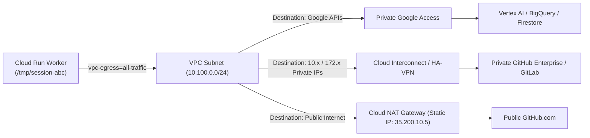

# 🏛️ Enterprise Architecture: Private GitOps, VPC Direct Egress & Secure Ingress Controls

This document specifies the enterprise-grade network topology, security controls, and infrastructure-as-code patterns for running CodeMender inside a **Google Cloud Virtual Private Cloud (VPC)**. It supports both **Public GitHub with Enterprise Controls** and **Private/On-Premises GitHub Enterprise / GitLab / Bitbucket**.

---

## 📑 Table of Contents
1. [Executive Summary & Security Objectives](#1-executive-summary--security-objectives)
2. [End-to-End Architecture Topology](#2-end-to-end-architecture-topology)
3. [Network Ingress Patterns (Public vs. Private Git)](#3-network-ingress-patterns-public-vs-private-git)
4. [Outbound Egress & Data Plane Routing](#4-outbound-egress--data-plane-routing)
5. [Private Git Repository Connectivity Scenarios](#5-private-git-repository-connectivity-scenarios)
6. [Security & Compliance Governance Controls](#6-security--compliance-governance-controls)
7. [Infrastructure-as-Code Blueprint (Terraform)](#7-infrastructure-as-code-blueprint-terraform)
8. [Architecture Comparison Matrix](#8-architecture-comparison-matrix)

---

## 1. Executive Summary & Security Objectives

In enterprise financial services, healthcare, and defense environments, AI developer tooling must comply with strict zero-trust standards:
* **Zero Public Worker Exposure:** Execution workers (`codemender-backend`) must have no public IP, no public URL, and be reachable only via internal VPC routing.
* **Deterministic Egress IP Allowlisting:** Outbound git traffic must originate from static, dedicated public IPs (Cloud NAT) to satisfy enterprise firewall rules.
* **Private Network Interconnect:** Ability to clone, scan, and verify source code hosted on private, non-internet-routable Git instances (`git.internal.corp`).
* **Data Loss Prevention (DLP):** Source code and Vertex AI tokens must be enclosed within a **VPC Service Controls (VPC-SC)** security perimeter.

---

## 2. End-to-End Architecture Topology

```mermaid
flowchart TD
    subgraph Git Sources [1. Source Code Repositories]
        GH_Pub["Public GitHub.com / GitHub Enterprise Cloud"]
        GH_Priv["Private On-Premises Git<br/>(GitHub Enterprise Server / GitLab / Bitbucket)"]
        CorporateUser["Enterprise Developers / Admins<br/>(Corporate Laptop via VPN / SSO)"]
    end

    subgraph GCP Ingress Perimeter [2. Ingress & Perimeter Security]
        WAF["Cloud Armor WAF Policy<br/>(GitHub IP CIDR Filter + DDoS Protection)"]
        ExtALB["External HTTPS Application Load Balancer<br/>(custom-domain.corp.com)"]
        IntALB["Internal Application Load Balancer (ILB)<br/>(10.100.0.100)"]
        IAP["Identity-Aware Proxy (IAP)<br/>(Okta / Azure AD / Google SSO)"]
    end

    subgraph GCP Serverless Compute [3. Isolated Cloud Run Workloads]
        WH["codemender-webhook Gateway<br/>• Ingress: Internal & Cloud Load Balancing<br/>• Concurrency: 80<br/>• DISABLE_UI: True"]
        DASH["codemender-dashboard Portal<br/>• Ingress: Internal & Cloud Load Balancing<br/>• Auth: Enforced by IAP"]
        BE["codemender-backend Workers<br/>• Ingress: STRICTLY INTERNAL<br/>• Concurrency: 1<br/>• RAM: 4 GiB, CPU: 2 vCPU"]
    end

    subgraph GCP VPC Network [4. Customer VPC Subnet (10.100.0.0/24)]
        Subnet["Dedicated CodeMender Subnet<br/>(Direct VPC Egress: vpc-egress=all-traffic)"]
        PGA["Private Google Access (PGA)<br/>(private.googleapis.com)"]
        CloudNAT["Cloud NAT Gateway<br/>(Static Elastic Egress IPs: 35.x.x.x)"]
        CloudDNS["Cloud DNS Private Zone<br/>(git.internal.corp -> 10.200.x.x)"]
        Interconnect["Cloud Interconnect / HA-VPN<br/>(BGP Peered to On-Prem WAN)"]
    end

    subgraph GCP Data Plane [5. Managed Services in VPC-SC Perimeter]
        Vertex["Vertex AI Gemini API<br/>(Private Endpoint)"]
        FS["Cloud Firestore Database"]
        BQ["BigQuery Telemetry (token_usage_log)"]
        SM["Secret Manager (GitHub Tokens / Keys)"]
        GCS["Cloud Storage (PoC Exploit Artifacts)"]
    end

    %% Ingress Flow - Public GitHub
    GH_Pub -->|POST /github-webhook| WAF --> ExtALB --> WH
    CorporateUser -->|HTTPS Dashboard Access| IAP --> ExtALB --> DASH
    
    %% Ingress Flow - Private Git
    GH_Priv -->|POST /github-webhook| Interconnect --> IntALB --> WH
    
    %% Internal Compute Flow
    WH -->|Internal Cloud Tasks / gRPC| BE
    
    %% Direct VPC Egress
    WH & DASH & BE -->|Direct VPC Egress| Subnet
    
    %% Outbound Egress Flows
    Subnet -->|Google Cloud API Calls| PGA --> Vertex & FS & BQ & SM & GCS
    Subnet -->|Outbound git clone to Public GitHub| CloudNAT -->|Fixed Static IP| GH_Pub
    Subnet -->|Outbound git clone to Private Git| CloudDNS --> Interconnect --> GH_Priv
```

---

## 3. Network Ingress Patterns (Public vs. Private Git)

### Pattern 1: Ingress for Public GitHub (`github.com`)
When using Public GitHub with an Enterprise VPC backend:
1. **GitHub IP Range Allowlisting on Cloud Armor:**
   * GitHub publishes official webhook IP CIDRs via `https://api.github.com/meta`.
   * Cloud Armor WAF allows **only** traffic from GitHub's published CIDRs (e.g., `192.30.252.0/22`, `185.199.108.0/22`, `140.82.112.0/20`) and drops all other public internet traffic.
2. **External HTTPS Application Load Balancer (ALB):**
   * Terminates TLS using a customer-managed SSL certificate (`https://codemender-webhook.corp.com`).
   * Routes traffic to a **Serverless Network Endpoint Group (NEG)** pointing to `codemender-webhook`.
3. **Application Signature Validation:**
   * `codemender-webhook` validates the `X-Hub-Signature-256` HMAC against the `GITHUB_WEBHOOK_SECRET`.

---

### Pattern 2: Ingress for Private / On-Premises Git (GitHub Enterprise Server / GitLab)
When source code is hosted on-premises or inside a private cloud:
1. **Zero Internet Exposure:** No public IPs, public URLs, or external load balancers are provisioned.
2. **Internal Application Load Balancer (ILB):**
   * Assigned a private IP inside the VPC subnet (e.g. `10.100.0.100`).
3. **Webhook Delivery over Cloud Interconnect / HA-VPN:**
   * When a developer pushes to the on-premise Git server, the on-premise webhook engine delivers `POST http://10.100.0.100/github-webhook` across the dedicated fiber interconnect directly into Google Cloud.

---

## 4. Outbound Egress & Data Plane Routing

### Direct VPC Egress (`--vpc-egress=all-traffic`)
* Cloud Run containers are provisioned with virtual interfaces directly on the `10.100.0.0/24` subnet.
* **100% of outbound packets** are routed through the customer VPC:



---

## 5. Private Git Repository Connectivity Scenarios

### Scenario A: Self-Hosted GitLab / GitHub Enterprise on Private Subnet
* **DNS Resolution:** Cloud DNS Private Zone configured for `git.corp.internal` $\rightarrow$ resolves to internal IP `10.200.40.15`.
* **Git Clone Execution:**
  ```bash
  # Executed inside Cloud Run container via private interconnect
  git clone https://git.corp.internal/security-tools/vulnerable-service.git /tmp/session-123
  ```
* **Custom Enterprise CA Certificates:** Pre-bake corporate root CA certificates into the container image (`/usr/local/share/ca-certificates/corp-root-ca.crt` followed by `update-ca-certificates`) to allow TLS validation against internal self-signed Git certificates.

---

### Scenario B: Public GitHub with IP Allowlisting (Egress Whitelist)
* **Firewall / Organization Allowlisting:** Enterprise GitHub organizations often restrict clone/push access to whitelisted CIDR blocks.
* **Static NAT IPs:** All CodeMender outbound clones and PR status updates originate from the Cloud NAT static IP pool (e.g. `35.200.10.5` and `35.200.10.6`), allowing simple firewall allowlisting.

---

## 6. Security & Compliance Governance Controls

### 1. VPC Service Controls (VPC-SC) Perimeter
The entire CodeMender project is placed inside a VPC-SC perimeter:
* Prevents data exfiltration by blocking any API request that attempts to write source code or scan logs to GCS buckets or BigQuery datasets outside the authorized project perimeter.

### 2. Identity-Aware Proxy (IAP) for Dashboard Portal
* The developer web UI (`codemender-dashboard`) is fronted by Google Cloud IAP.
* Requires user authentication through Corporate Single Sign-On (SSO) before granting access to vulnerability scan dashboards, with granular IAM role access (`roles/iap.httpsResourceAccessor`).

### 3. Dedicated Execution Isolation (`concurrency = 1`)
* Every verification task runs inside a fresh, isolated Cloud Run container instance with dedicated RAM (4 GiB) and CPU (2 vCPU).
* Containers scale to zero when idle, eliminating persistent infrastructure attack surfaces.

---

## 7. Infrastructure-as-Code Blueprint (Terraform)

```hcl
# 1. Dedicated VPC Subnet
resource "google_compute_subnetwork" "codemender_subnet" {
  name                     = "codemender-subnet"
  ip_cidr_range            = "10.100.0.0/24"
  region                   = "us-central1"
  network                  = google_compute_network.enterprise_vpc.id
  private_ip_google_access = true
}

# 2. Static Egress IP for Cloud NAT
resource "google_compute_address" "nat_static_ip" {
  name   = "codemender-nat-static-ip"
  region = "us-central1"
}

# 3. Cloud NAT for Controlled Internet Egress
resource "google_compute_router_nat" "nat_gateway" {
  name                               = "codemender-nat"
  router                             = google_compute_router.enterprise_router.name
  region                             = "us-central1"
  nat_ip_allocate_option             = "MANUAL_ONLY"
  nat_ips                            = [google_compute_address.nat_static_ip.self_link]
  source_subnetwork_ip_ranges_to_nat = "LIST_OF_SUBNETWORKS"
  subnetwork {
    name                    = google_compute_subnetwork.codemender_subnet.id
    source_ip_ranges_to_nat = ["ALL_IP_RANGES"]
  }
}

# 4. Cloud Armor Security Policy (GitHub Ingress Allowlist)
resource "google_compute_security_policy" "github_webhook_armor" {
  name        = "github-webhook-armor-policy"
  description = "Allows only official GitHub webhook IP ranges"

  rule {
    action   = "allow"
    priority = "1000"
    match {
      versioned_expr = "SRC_IPS_V1"
      config {
        # Official GitHub Webhook IP CIDR blocks (from api.github.com/meta)
        src_ip_ranges = [
          "192.30.252.0/22",
          "185.199.108.0/22",
          "140.82.112.0/20",
          "143.55.64.0/20"
        ]
      }
    }
    description = "Allow official GitHub Webhook IPs"
  }

  rule {
    action   = "deny(403)"
    priority = "2147483647"
    match {
      versioned_expr = "SRC_IPS_V1"
      config {
        src_ip_ranges = ["*"]
      }
    }
    description = "Default deny all other traffic"
  }
}

# 5. Cloud Run Worker with Direct VPC Egress & Internal Ingress
resource "google_cloud_run_v2_service" "codemender_backend" {
  name     = "codemender-backend"
  location = "us-central1"
  ingress  = "INGRESS_TRAFFIC_INTERNAL_ONLY"

  template {
    scaling {
      max_instance_count = 50
    }
    containers {
      image = "us-central1-docker.pkg.dev/YOUR_PROJECT/cloud-run-source-deploy/codemender-backend:latest"
      resources {
        limits = {
          cpu    = "2"
          memory = "4Gi"
        }
      }
    }
    vpc_access {
      network_interfaces {
        network    = google_compute_network.enterprise_vpc.id
        subnetwork = google_compute_subnetwork.codemender_subnet.id
      }
      egress = "ALL_TRAFFIC"
    }
  }
}
```

---

## 8. Architecture Comparison Matrix

| Architectural Capability | Standard Public Setup | 🛡️ Enterprise VPC Architecture |
| :--- | :---: | :---: |
| **Worker Ingress** | Public `*.run.app` with IAM | **Internal Only (Completely Unreachable from Internet)** |
| **Webhook Ingress Filtering** | App-level HMAC verification | **Cloud Armor WAF (GitHub IP CIDR Whitelist) + HMAC** |
| **Dashboard Authentication** | Application-level login | **Google Identity-Aware Proxy (Corporate Okta/Azure SSO)** |
| **Outbound Egress Routing** | Default Google Internet Gateway | **100% Routed via VPC Subnet (`vpc-egress=all-traffic`)** |
| **Outbound Source IP** | Ephemeral, non-deterministic | **Deterministic Static IP (Cloud NAT)** |
| **Private Git Support** | ❌ Not supported | ✅ **Full Support via Cloud Interconnect / HA-VPN** |
| **Data Exfiltration Perimeter**| ❌ None | ✅ **VPC Service Controls (VPC-SC) Perimeter** |
| **Container Sandbox Isolation**| Shared container instance | **1 Container per Execution (`concurrency = 1`)** |
