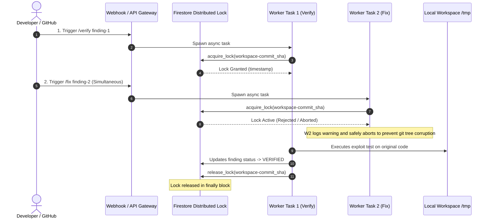
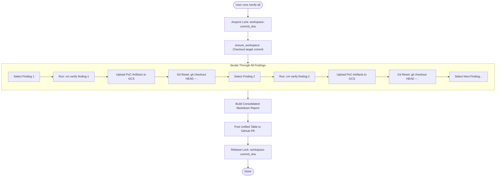
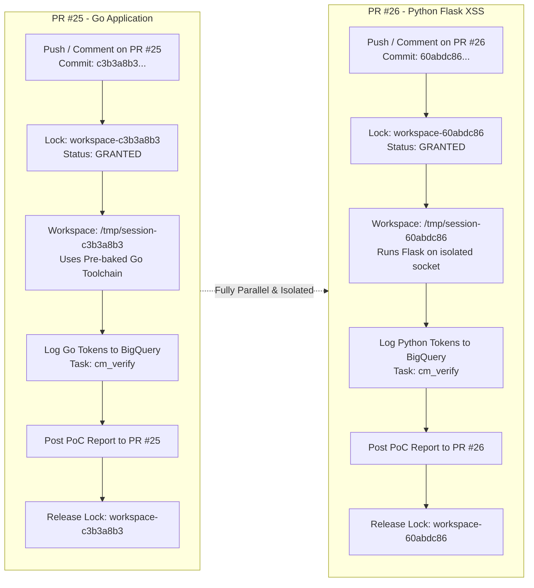
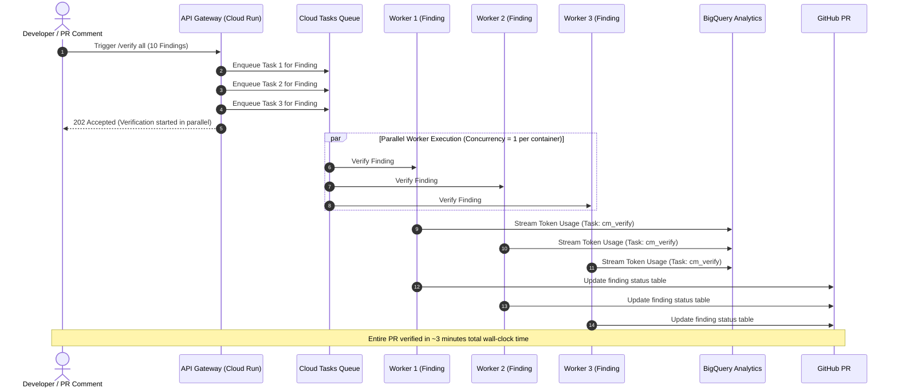
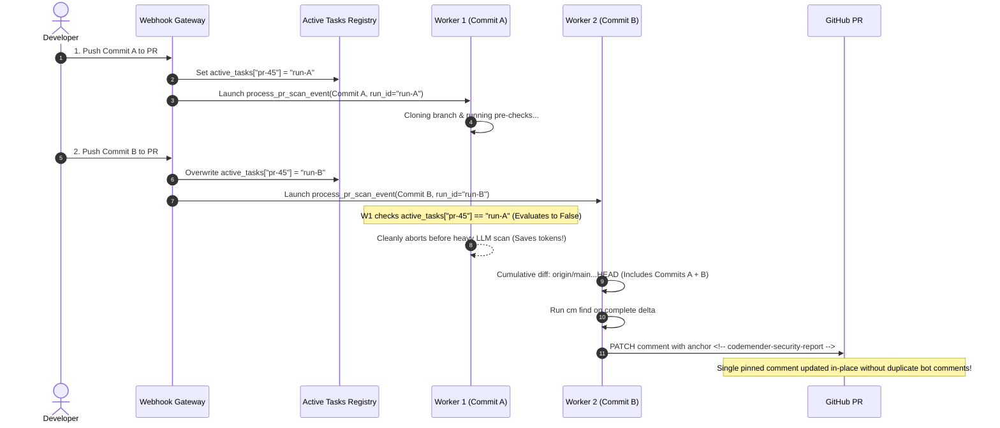

# 🔄 CodeMender Parallel Execution & Concurrency Architecture

This visual guide details how CodeMender handles parallel actions, distributed locks, and resource isolation across different operational scenarios.

---

## 📑 Scenarios Covered
1. [Scenario 1: Actions on the SAME Commit (Verify All, Verify + Fix Race Prevention)](#-scenario-1-actions-on-the-same-commit)
2. [Scenario 2: Actions on SEPARATE Commits (Parallel Scans & PR Verifications)](#-scenario-2-actions-on-separate-commits)
3. [Scenario 3: Enterprise Map-Reduce Finding Sharding](#-scenario-3-enterprise-map-reduce-finding-sharding)
4. [Summary Comparison Matrix](#-summary-comparison-matrix)

---

## 🟢 Scenario 1: Actions on the SAME Commit

> [!IMPORTANT]
> **Core Principle:** Any task modifying a workspace at `/tmp/session-{commit_sha}` MUST acquire a distributed Firestore lock on `workspace-{commit_sha}`.

### 1.1 Race Prevention (Verify + Fix at the Same Time)

If a developer clicks "Verify" and immediately clicks "Fix", or if two PR comments arrive simultaneously for the same commit:

---

### 1.2 How `/verify all` Runs (Sequential Finding Loop)

When verifying multiple findings on the same commit, the single task holds the lock and iterates sequentially with clean git workspace resets:

---

## 🔵 Scenario 2: Actions on SEPARATE Commits

> [!TIP]
> **Core Principle:** Tasks on different commits use different lock IDs (`workspace-c3b3...` vs `workspace-60ab...`) and completely isolated `/tmp` workspace folders. They execute 100% concurrently without blocking.

---

## ⚡ Scenario 3: Enterprise Map-Reduce Finding Sharding

For massive repositories with 10+ findings, the gateway shards findings across parallel Cloud Run worker instances:

---

## ⚡ Scenario 4: Draft PR Iterative Commit Superseding & In-Place Reporting

When a developer rapidly pushes multiple commits to an active Draft PR (e.g. Commit B pushed while Commit A is still being analyzed):

---

## 📊 Summary Comparison Matrix

| Concurrency Scenario | Lock ID Used | Workspace Path | Execution Mode | Behavior / Protection |
| :--- | :--- | :--- | :---: | :--- |
| **Verify + Fix on same PR** | `workspace-{head_sha}` | `/tmp/session-{head_sha}` | **Sequential / Mutex** | First task acquires lock; second task aborts to prevent git tree corruption. |
| **`/verify all` on same PR** | `workspace-{head_sha}` | `/tmp/session-{head_sha}` | **Sequential Loop** | 1 task holds lock, iterates findings, resets workspace between each test. |
| **Simultaneous PR #25 & PR #26** | `workspace-{sha1}` `workspace-{sha2}` | `/tmp/session-{sha1}` `/tmp/session-{sha2}` | **100% Parallel** | Independent locks & directories. Upgraded 4GB RAM handles both without OOM. |
| **Sharded Finding Verification** | `workspace-{sha}-{finding_id}` | Isolated container `/tmp` | **Map-Reduce Parallel** | $N$ parallel containers verify $N$ findings simultaneously in $\approx 3$ minutes flat. |
| **Iterative PR Commits** | `workspace-{head_sha}` | `/tmp/session-{head_sha}` | **Superseding Cancel** | Active task registry cancels older in-flight scan; updates pinned comment in-place. |
